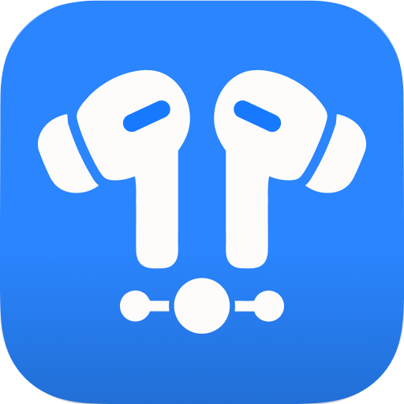
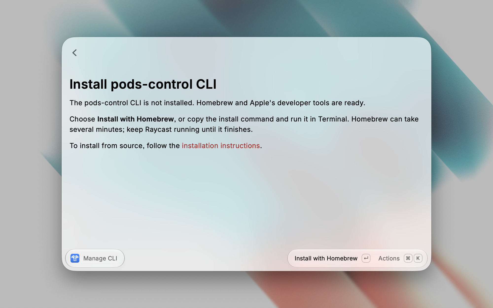

  

<h1 align="center">Pods Control Raycast Extension</h1>

  
  
  
  

  

A Raycast extension that reads and changes the listening mode and Conversation Awareness of the connected AirPods or Beats, and shows the confirmed state in command subtitles.

The [development repository](https://github.com/raulgg/raycast-extension-pods-control) is where the extension is developed and tested. What the [Raycast Store](https://www.raycast.com/raulg/pods-control) publishes lives in [`extension/`](extension/). Setup, requirements, and troubleshooting are in the [extension README](extension/README.md).

## Features

- Set the listening mode to Off, Transparency, Adaptive, or Noise Cancellation.
- Cycle Listening Mode moves to the next enabled listening mode after the confirmed one. It follows listening mode order, wraps around, and skips modes the device does not support.
- Toggle Conversation Awareness between On and Off.
- Cycle Listening Mode and Toggle Conversation Awareness show that feature's confirmed state in the subtitle. Pods Status shows the listening mode and Conversation Awareness together in the status subtitle.
- Pods Status runs a status refresh and updates every subtitle from it. Turn on its background refresh to repeat that refresh every minute.
- Manage CLI detects, installs, updates, or repairs the [CLI](https://github.com/raulgg/pods-control).

Set to Adaptive and Set to Off start disabled. Adaptive needs a device that supports it. Off needs Off Listening Mode on in the device settings.

## Screenshots

Commands in Raycast. Cycle Listening Mode, Toggle Conversation Awareness, and Pods Status show the confirmed state. The set commands and Manage CLI show the default subtitle.

Manage CLI when the CLI is not installed. Homebrew and Apple's developer tools are ready, and the next action is Install with Homebrew.

## Contribute to the extension

Tests, test tooling, and the contributor docs stay at the root of the development repository. Read [CONTRIBUTING.md](CONTRIBUTING.md) before changing the extension. [ARCHITECTURE.md](ARCHITECTURE.md) maps the code, and [GLOSSARY.md](GLOSSARY.md) defines the terms used here.
